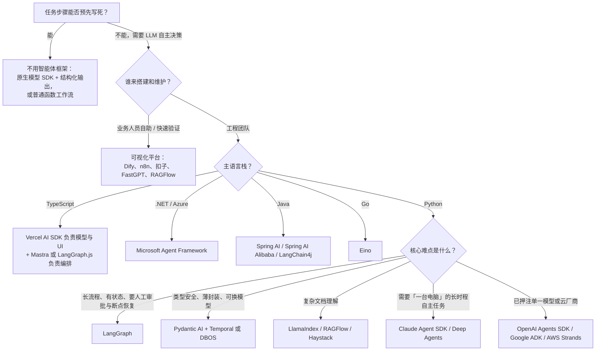

# LangChain 系领跑，官方 SDK 改写智能体框架版图

截至 2026 年 10 月（数据采集于 2026-10-21），**写代码用的智能体框架里最火的仍是 LangChain 系（LangChain + LangGraph + Deep Agents）**。它是唯一在开发者调查、包下载量、GitHub star 增量三项指标上同时领先的阵营：Stack Overflow 2026 调查中 LangChain 以 **30.2%** 居首，LangGraph **18.8%** 排第四；PyPI 近 30 天下载分别为 **1.70 亿**和 **4,477 万**（[Stack Overflow 2026](https://survey.stackoverflow.co/2026/ai/data)、[pypistats](https://pypistats.org/packages/langgraph)）。第二极是**模型和云厂商的官方 SDK**，它们在约 18 个月内从零做到千万级月下载，或冲进调查前五。这一极包括 OpenAI Agents SDK（调查 23.8%）、Google ADK（14.0%）、Claude Agent SDK（npm 月下载 4,794 万，一年增长约 50 倍）、AWS Strands（PyPI 月下载 3,711 万），以及 2026 年 4 月 GA、接替 AutoGen 与 Semantic Kernel 的 Microsoft Agent Framework。TypeScript 生态由 Vercel AI SDK（npm 月下载 **1.19 亿**）和 Mastra 主导；Python 里“薄而类型安全”的路线以 Pydantic AI（8.9%）为代表，热度持续上升。如果只看 star，最热的其实是平台型的 n8n（20.8 万）和 Dify（15.9 万）。中国社区集中在 Dify、RAGFlow、AgentScope、DeerFlow、扣子，代码框架按语言分工，Go 用 Eino，Java 用 Spring AI Alibaba。与此同时，**AutoGen 已在 README 中声明归档，Flowise 已停运，MetaGPT 停更，CrewAI 的调查份额从 7.5% 降到 5.5%**。这些变化指向同一个结论：框架之争已经从“谁的 agent 抽象更好”变成“谁的运行时更可靠、harness 更完整”。运行时指持久执行、人在回路（HITL）、检查点；harness 指 agent 的外壳和运行环境，包括文件系统、沙箱、上下文压缩、子智能体。MCP 支持已经是入门门槛，不再构成差异。需要提醒的是，“热度”没有统一口径：star、下载量和调查给出的排名差别很大。本报告以三者交叉印证为准，无法核实的地方会单独标出。

## 三项指标给出三种排名，只有 LangChain 系在三项上都领先

“最火”至少有三种量法，答案并不一致。**GitHub star 反映关注度，但和真实使用可能严重脱节。** MetaGPT 有 7.1 万 star，PyPI 月下载却只有 **3,393 次**（[pypistats](https://pypistats.org/packages/metagpt)）。一项覆盖 1,575 个 GitHub 项目的实证研究发现，依赖 LangChain 的项目有 105 个，依赖 MetaGPT 的只有 2 个，作者的结论是 star 不能可靠预测实际采用（[arXiv 2512.01939](https://arxiv.org/html/2512.01939v1)）。**下载量反映安装次数，但会被 CI 和依赖传递放大。** Claude Agent SDK 只有 8.3k star，npm 月下载却有 **4,794 万**（[npm](https://www.npmjs.com/package/@anthropic-ai/claude-agent-sdk)）。**平台型项目得看 Docker 拉取。** n8n 累计拉取 2.74 亿次，star 数与它同一量级的 Langflow 只有 433 万次（[Docker Hub n8n](https://hub.docker.com/r/n8nio/n8n)、[Docker Hub Langflow](https://hub.docker.com/r/langflowai/langflow)）。**开发者调查最接近“真的在用”。** 目前最新、最权威的是 2026-10-06 发布的 Stack Overflow 2026 调查，参与者超过 3 万人，“智能体编排/框架”一题有 4,400 人作答（[Stack Overflow Blog](https://stackoverflow.blog/2026/10/06/the-results-of-the-2026-developer-survey-are-here/)）。下表把三类数据并排列出，在多项指标上同时领先才算“最火”。

| 框架 | SO 2026 使用率 | 主包月下载 | GitHub Star | 近 52 周新增 star | 热度判断 |
|---|---|---|---|---|---|
| LangChain | **30.2%**（第 1） | PyPI 1.70 亿 | 148,186 | +32,907 | 第一档 |
| LangGraph | **18.8%**（第 4） | PyPI 4,477 万；npm 1,481 万 | 43,628 | +23,922（+121%） | 第一档 |
| Deep Agents（LangChain） | 未列为选项 | PyPI 566 万；npm 144 万 | 30,469 | +26,145（**+605%**） | 增速最快 |
| OpenAI Agents SDK | **23.8%**（第 2） | PyPI 1,245 万；npm 839 万 | 30,192 | +13,941 | 第二档 |
| Google ADK | 14.0% | PyPI 1,011 万；npm 118 万 | 21,933 | +8,435 | 第二档 |
| Claude Agent SDK | 未列为选项 | PyPI 2,978 万；npm **4,794 万** | 8,316 | +5,667 | 第二档（下载驱动） |
| AWS Strands | 4.0% | PyPI **3,711 万** | 8,889 | +5,180 | 第二档（下载驱动，社区声量小） |
| Microsoft Agent Framework | 未列为选项 | PyPI 约 101 万 | 14,244 | +10,347（+266%） | 上升中 |
| Vercel AI SDK（TS） | 9.0% | npm **1.19 亿** | 27,428 | +9,223 | TS 第一 |
| Pydantic AI | 8.9% | PyPI 538 万（slim 包 2,391 万） | 20,764 | +8,015 | 第二档 |
| Mastra（TS） | 3.0% | npm 803 万 | 28,972 | +11,739 | TS 新贵 |
| CrewAI | 5.5%（2025 年 7.5%） | PyPI 244 万 | 59,942 | +21,466 | 声量高、动能减弱 |
| LlamaIndex | 2026 榜单未出现 | PyPI 657 万（core） | 52,592 | +8,506 | 细分（文档） |
| DSPy | 3.6% | PyPI 531 万 | 38,712 | +9,763 | 细分（prompt 优化） |
| Agno | 2.4% | PyPI 178 万 | 42,850 | +9,191 | 细分 |
| AgentScope（阿里） | 未列为选项 | PyPI 20 万 | 33,581 | +20,523（+157%） | 中国增速最快的代码框架 |
| n8n（平台） | 自动化类 32.7% | Docker 累计 2.74 亿 | 208,191 | +62,837 | 平台第一 |
| Dify（平台） | 2.9% | Docker 累计 2,502 万（dify-api） | 159,108 | +44,876 | 平台第二 / 中国第一 |
| DeerFlow（字节） | 未列为选项 | — | 84,230 | **+67,039**（+390%） | 应用级 harness |

数据来源：调查数据来自 [Stack Overflow 2026 AI 数据页](https://survey.stackoverflow.co/2026/ai/data)；PyPI 为 [pypistats](https://pypistats.org/packages/langchain) 近 30 天、不含镜像；npm 为 [npm 下载 API](https://api.npmjs.org/downloads/point/last-month/ai) 2026-09-19 至 10-18；star 及 52 周增量为 2026-10-21 用 GitHub REST API 和 [star 历史接口](https://docs.github.com/en/rest/activity/starring?apiVersion=2026-03-10#get-repository-star-history) 实测。

三项交叉后，格局比较清楚。**LangChain 系是唯一在三项上都领先的阵营。** LangChain 调查和下载都是第一，LangGraph 调查第四、下载第二，Deep Agents 一年 star 增长 605%。公司旗下三个仓库近 52 周合计新增约 8.3 万 star，同一时期公司在 2025-10 宣布 1.25 亿美元 B 轮（估值 12.5 亿美元），同时发布 1.0 稳定版（[Fortune](https://fortune.com/2025/10/20/exclusive-early-ai-darling-langchain-is-now-a-unicorn-with-a-fresh-125-million-in-funding/)）。**官方 SDK 构成第二极，但内部结构不同。** OpenAI Agents SDK 和 Google ADK 的强项是调查份额，Claude Agent SDK 和 Strands 的强项是下载量。后两者 star 都偏低，说明它们主要靠模型或云平台分发，而不是社区主动收藏。和 2025 年相比，LangGraph 的调查份额从 16.2% 升到 18.8%，AutoGen 从 12.0% 跌到 4.5%，CrewAI 从 7.5% 降到 5.5%（[SO 2025](https://survey.stackoverflow.co/2025/ai)）。这轮洗牌里，角色扮演式多智能体框架是最明显的输家。

另一个容易被忽视的信号是**整体降温**。用 GitHub 2026-09 新开放的 star 历史接口计算，主流框架近 13 周的 star 流入大多低于前 13 周，“加速比”（近 13 周新增 ÷ 前 13 周新增）的中位数约 **0.75**。仍在加速的只有几个：AWS Strands（2.28，改名为 harness-sdk 后集中涨星）、AgentScope（1.35，2.0 发布后）、DSPy（1.04），以及语音智能体框架 LiveKit Agents（2.50）和 Pipecat（1.41）（[GitHub Docs](https://docs.github.com/en/rest/activity/starring?apiVersion=2026-03-10#get-repository-star-history)）。同期的关注度被编码智能体吸走了，OpenAI Codex 的加速比是 1.33。不过 **star 降温不等于使用减少**：npm 上几乎所有智能体 SDK 一年内都增长了数倍，LangGraph.js 5.5 倍、OpenAI Agents SDK 13.9 倍、Mastra 7.3 倍（[npm 下载 API](https://api.npmjs.org/downloads/point/last-month/ai)）。

### 这份排名的已知盲区

以下几点会影响排名的可信度，必须说明。第一，**PyPI 在 2026-09 出现断崖式下跌**：semantic-kernel −87%、crewai −91%、openai-agents −65%，而 claude-agent-sdk、strands、deepagents 基本持平。各包降幅差别这么大，更像是大规模 CI 安装方或统计口径发生了变化，不像开发者真的流失了。所以 PyPI 数字只适合比较量级，月度趋势应以 npm 为准（[pypistats](https://pypistats.org/packages/crewai)）。第二，Claude Agent SDK 和 Strands 的超高下载量**很可能来自被其他工具捆绑或依赖**，而不是开发者主动选用。这是推断，目前找不到公开的依赖拆解数据。第三，SO 2026 调查**没有把 Claude Agent SDK 和 Microsoft Agent Framework 列为选项**，因此无法和其他框架直接比较。调查里的 Llama Stack 拿到 17.4%，本次研究没有调查它，也解释不了这个份额。“Terminal Use”拿到 18.9%，调查方的解读是许多开发者偏好直接、轻量的编排（[SO 2026 AI](https://survey.stackoverflow.co/2026/ai)）。第四，SO 样本以欧美开发者为主，Dify、AgentScope、扣子等中国生态项目被系统性低估。本次**没有找到任何带框架使用率的权威中文调查**，所以下文对中国生态的热度排序属于定性判断。

## 模型中立框架分化：LangGraph 管状态，Pydantic AI 求类型，CrewAI 退守原型

**LangChain 系的优势在于分层：同一套运行时上有三档抽象，用户可以从高层逐步下沉。** 最底层的 LangGraph 自我定位为“very low-level”的编排运行时。开发者用 `StateGraph` 显式声明状态、节点和边，同一张图里可以混合写死的步骤和由 LLM 决策的步骤。它提供 durable execution（故障后从断点恢复）、随时可插入的人工介入、跨会话记忆和流式输出（[LangGraph 文档](https://docs.langchain.com/oss/python/langgraph/overview)）。持久化由 checkpointer 按 `thread_id` 存储每一步的状态，生产环境用 `PostgresSaver`；对话连续、人工审批、time travel（回到历史状态重跑）、容错这四类能力都建立在它之上（[持久化文档](https://docs.langchain.com/oss/python/langgraph/persistence)）。中间层是 LangChain 1.0 的 `create_agent` 加 middleware，内置人工审批、上下文快满时自动摘要、PII 脱敏。官方承诺 **“2.0 之前不做破坏性变更”**（[LangChain 1.0 博客](https://www.langchain.com/blog/langchain-langgraph-1dot0)）。最上层的 Deep Agents 是“开箱即用的 harness”，自带规划工具、虚拟文件系统、隔离的子智能体、Skills，以及从 `AGENTS.md` 加载的长期记忆（[Deep Agents 文档](https://docs.langchain.com/oss/python/deepagents/overview)）。它重点解决长时间运行、有状态、需要暂停审批、又要可审计的“半确定性”流程。官方案例中，Klarna 基于 LangGraph 的客服助手服务 8,500 万活跃用户，问题解决时间缩短 80%；Uber 用它做大规模代码迁移（[Built with LangGraph](https://www.langchain.com/built-with-langgraph)，属厂商营销材料）。代价是学习曲线和历史包袱：对 GitHub 讨论的实证分析显示，约 42% 的 LangChain 开发者认为层层嵌套的抽象拖慢了进度（[arXiv 2512.01939](https://arxiv.org/html/2512.01939v1)），Octomind 也曾因为抽象难以改动而公开弃用 LangChain（[Octomind](https://octomind.dev/blog/why-we-no-longer-use-langchain-for-building-our-ai-agents)）。对于一问一答的简单任务，图模型属于过度设计。

**Pydantic AI 代表 2026 年口碑上升最快的路线：薄、类型安全、可换模型。** 它的核心卖点是“Typed end to end”：输出、工具参数和依赖注入都用 Pydantic 模型约束，类型检查器在编写阶段就能发现错误。它原生接入 OpenTelemetry/Logfire（[Pydantic AI 文档](https://pydantic.dev/docs/ai/overview/)）。持久化执行可以接 Temporal、DBOS、Prefect、Restate 等 **8 种引擎**（[持久化执行文档](https://github.com/pydantic/pydantic-ai/blob/main/docs/durable_execution/overview.md)）。2026-06-23 发布的 V2 转向“harness-first”，新增的 Capability 原语把指令、工具、hooks 和模型设置打包成可组合的单元（[V2 Release](https://github.com/pydantic/pydantic-ai/releases/tag/v2.0.0)）。在 Hacker News 上，它反复被开发者称为“go-to”，常被拿来替代 LangChain（[HN 评论检索](https://hn.algolia.com/api/v1/search?query=%22pydantic%20ai%22&tags=comment&hitsPerPage=25&numericFilters=created_at_i%3E1735689600)）。MindsDB 从 LangChain 迁到 Pydantic AI 后，一个月内智能体性能提升 10 倍（[Pydantic 案例](https://pydantic.dev/case-studies/mindsdb)，厂商自述）。它最适合已有 FastAPI/Pydantic 技术栈、需要强结构化输出和审批长流程的 Python 后端团队。短板是只支持 Python，几乎每天发版，V2 的 Harness 包还处于早期。

**LlamaIndex 和 Haystack 转向以文档为中心的生产栈。** LlamaIndex 的仓库描述已经改成“the document processing platform for AI”（[GitHub](https://github.com/run-llama/llama_index)），商业重心在 LlamaParse 的解析、抽取、分类（[官网](https://www.llamaindex.ai/)）。开源编排层是事件驱动的 Workflows（[PyPI](https://pypi.org/project/llama-index-workflows/)），core 包至今仍是 0.x。它最适合合同、财报、发票、尽调这类“读懂复杂文档才是难点”的场景。Haystack 在 2026-07-20 发布 3.0，主打可序列化、能在 Kubernetes 上运行的 pipeline，并给 Agent 加了六个 hook 挂载点（[Haystack 3.0 发布说明](https://haystack.deepset.ai/release-notes/3.0.0)），适合注重透明、厂商中立、需要私有化部署的生产级 RAG。**DSPy** 走另一条路，口号是“Program, don't prompt”：用 Signature、Module、Optimizer 替代手写 prompt，再用 GEPA、MIPROv2 等优化器按评测指标自动调优（[dspy.ai](https://dspy.ai/current/)）。它不是完整的应用框架，价值在于有评测数据时做可度量的优化，以及在不同模型之间迁移。

**CrewAI 的问题不在知名度，而在动能。** 它的“角色 + 任务 + 团队”抽象最直观：Crews 负责自主协作，Flows 负责事件驱动的精确控制（[CrewAI README](https://github.com/crewAIInc/crewAI)）。但官方文档现在推荐的做法是“用 Flow 搭骨架，只在需要自主协作的那一步嵌入 Crew”（[CrewAI 文档](https://docs.crewai.com/en/introduction)），这实际上是向图编排靠拢。两项独立基准都显示它的 **token 开销最高**。AIMultiple 的旅行规划任务中，CrewAI 输出 5,339 tokens，LangGraph 为 2,589（[AIMultiple](https://aimultiple.com/agentic-orchestration)）。另一项可复现测试中，CrewAI 每次运行约 27,684 tokens，大约是 Microsoft Agent Framework 的 4 倍（[DEV](https://dev.to/lukaszgrochal/i-benchmarked-5-ai-agent-frameworks-heres-what-actually-matters-3ela)）。它仍然适合角色分工明确的内容和报告流水线原型，但上生产前需要评估成本和可调试性。**Agno** 把框架升级成了“框架 + AgentOS 运行时”，自带 API、存储、RBAC、多租户和调度（[Agno README](https://github.com/agno-agi/agno)）。它“实例化比 LangGraph 快 529 倍”的宣传只是微基准：独立复测确认实例化快约 305 倍，但内存优势只有约 5.8 倍，且和端到端延迟基本无关（[Towards AI](https://pub.towardsai.net/agno-says-it-builds-agents-529-faster-than-langgraph-i-measured-what-that-actually-buys-you-a3c9cb6c198a)）。

**TypeScript 生态是“工具包 + 全家桶”的双寡头格局。** Vercel AI SDK 是下载量最大的 TS LLM 工具包，统一了多家模型的接口，`useChat` 流式 UI 是事实标准。2026-06-25 发布的 v7 新增可在进程重启后恢复的 `WorkflowAgent`，以及实验性的 `HarnessAgent`，可以用统一接口驱动 Claude Code、Codex、Deep Agents 等外部 harness（[AI SDK 7](https://vercel.com/blog/ai-sdk-7)）。代价是大约每半年一次破坏性大版本，v7 还改成了 ESM-only。Mastra 由 Gatsby 原班人马创立，2026-01-20 发布 1.0，把 agent、workflow、memory、RAG、evals 和 Studio 做成一站式方案。2026-04 它完成 Spark Capital 领投的 2,200 万美元 A 轮，并转型为平台公司（[Mastra 博客](https://mastra.ai/blog/series-a)）。需要警惕的是，2026-06-17 发生了 npm 供应链攻击，上百个 `@mastra/*` 包被注入窃密依赖（[Socket](https://www.socket.dev/blog/mastra-npm-packages-compromised)）。

| 框架 | 一句话定位 | 核心优势 | 重点解决的场景 | 主要短板 |
|---|---|---|---|---|
| LangGraph（含 `create_agent`、Deep Agents） | 有状态智能体编排运行时 + 三层产品线 | 显式 state/节点/边；checkpointer、interrupt 审批、time travel、流式；生态与生产案例最多；1.0 稳定承诺 | 长时运行、可暂停恢复、可审计的半确定性流程；分层多智能体；深度研究和编码 | 学习曲线与样板代码；简单任务过重；历史 API 动荡的口碑包袱 |
| Pydantic AI | 端到端类型安全的 Python 生产栈 | 类型化输出、工具与依赖注入；OTel/Logfire；8 种持久化引擎；MCP、A2A、AG-UI | FastAPI/Pydantic 技术栈的结构化抽取与业务流程；审批类长流程 | 仅 Python；发版极频繁；V2 Harness 尚早 |
| LlamaIndex | 文档处理平台 + 文档智能体 | LlamaParse 解析/抽取；RAG 积累深；事件驱动 Workflows | 合同、财报、发票等文档密集任务；投研尽调 | core 仍为 0.x；编排层只剩 Python |
| Haystack 3.x | 透明、可部署的 pipeline + agent | 可序列化、可上 K8s、厂商中立、主权 AI 企业版 | 生产级 RAG、企业搜索、私有化部署 | 3.0 有破坏性变更；社区规模较小 |
| DSPy | 把 prompt 编译成可优化的程序 | Signature/Module/Optimizer；GEPA、MIPROv2 按指标优化 | 有评测指标的 RAG、抽取、多跳 QA；模型迁移与降本 | 不是完整应用框架；范式陌生；优化需要数据和算力 |
| CrewAI | 角色化多智能体团队 | 抽象最直观；Crews + Flows；商业控制面 AMP | 角色分工明确的内容/报告流水线、业务自动化原型 | token 开销最高；自主模式难调试；份额下滑 |
| Agno | 框架 + AgentOS 运行时 | 自带 API、存储、RBAC、多租户、调度、审批 | 把 agent 做成 SaaS 或内部平台、自托管 | 性能宣传依赖微基准；3.0 需迁移数据库 |
| Vercel AI SDK | TS 模型与 UI 工具包 | 统一多家模型、`useChat` 流式 UI、v7 持久化 WorkflowAgent | Next.js/React 的聊天和生成式 UI、多模型切换 | 约半年一次破坏性大版本；不是全家桶 |
| Mastra | TS 一站式框架 + 平台 | agent、workflow、memory、RAG、evals、Studio 一体；商业公司全职维护 | Node/Next.js 全栈团队的生产智能体 | 迭代过快；2026-06 供应链事件；部分代码为 `ee` 商业许可 |

## 官方 SDK 用 18 个月冲到千万级下载，代价是不同程度的模型锁定

2025 年的调查选项里还没有 OpenAI Agents SDK 和 Google ADK，到 2026 年它们直接以 23.8% 和 14.0% 冲进前五（[SO 2026](https://survey.stackoverflow.co/2026/ai/data)）。五家官方 SDK 的共同点是：和自家模型的新能力同步最快，都在 2026 年补齐了沙箱和 harness。它们的分野主要在锁定程度和目标技术栈。

**OpenAI Agents SDK 的优势是原语最少、上手最快。** 官方称它是实验项目 Swarm 的“production-ready upgrade”，核心只有 Agents、Handoffs（agent 间转交）、Guardrails、Sessions、Tracing 几个原语，另有沙箱 agent、实时语音 agent 和内置 MCP（[官方文档](https://openai.github.io/openai-agents-python/)）。2026-04 它新增原生沙箱和面向长时任务的 harness（[TechCrunch](https://techcrunch.com/2026/04/15/openai-updates-its-agents-sdk-to-help-enterprises-build-safer-more-capable-agents/)）。2026-09-10，托管 Codex harness 的 Agents API 进入公测（[OpenAI Changelog](https://developers.openai.com/api/docs/changelog)）。它最适合基于 OpenAI 模型、用 handoff 做转接的客服分诊、语音和电话智能体，以及需要护栏的企业流程。有一条值得记住的信号：OpenAI 在 DevDay 2025 推出的可视化 Agent Builder 将于 **2026-11-30 关停**，官方建议迁移到 Agents SDK（[OpenAI Deprecations](https://developers.openai.com/api/docs/deprecations)）。厂商托管的无代码层一年就退场，代码层反而更稳。它的弱点是版本仍为 0.x（Python 0.24.0），迭代快；接其他厂商模型要走 LiteLLM 等适配器，能力不对等。

**Claude Agent SDK 是开箱即用程度最高的 harness。** 官方定义是“Build production AI agents with Claude Code as a library”。它把 Claude Code 背后的文件读写、命令执行、搜索工具，以及 agent 循环、上下文压缩、权限、hooks、子智能体、skills、plugins 全部开放出来（[Agent SDK 文档](https://code.claude.com/docs/en/agent-sdk/overview)）。2025-09-29 由 Claude Code SDK 更名而来，理由是这套 harness 也能驱动研究、金融、客服等非编码智能体，核心理念是“给 Claude 一台电脑”（[Claude Blog](https://claude.com/blog/building-agents-with-the-claude-agent-sdk)）。Apple 在 Xcode 26.3 中原生集成了它（[Anthropic](https://anthropic.com/news/apple-xcode-claude-agent-sdk)）。它重点解决编码智能体、需要文件系统和终端的长时程自主任务、CI 中的无人值守任务。代价是**模型层强锁定**：只能用 Claude，渠道可以是 Anthropic API、Bedrock、Google 或 Microsoft Foundry。SDK 还以子进程方式驱动打包的 Claude Code 原生二进制，部署形态比纯库更重（[Quickstart](https://code.claude.com/docs/en/agent-sdk/quickstart)）。托管版 Claude Managed Agents 仍是 beta，且不符合 ZDR 与 HIPAA 要求（[Managed Agents 文档](https://platform.claude.com/docs/en/managed-agents/overview)）。

**Google ADK 的长处是语言覆盖和工作流可控。** 它支持 Python、TypeScript、Go、Java、Kotlin 五种语言，评估工具（用户模拟、环境模拟）和 A2A 支持都是厂商 SDK 中最完整的之一（[adk.dev](https://adk.dev/)）。2026 年的 ADK 2.0 把执行模型从层级 agent 执行器改成**图式 Workflow Runtime**，agent、工具、函数都作为节点运行，Python 版于 2026-05-19 GA（[ADK 2.0](https://adk.dev/2.0/)）。官方自述是“model-agnostic and deployment-agnostic, though optimized for Gemini”（[PyPI](https://pypi.org/project/google-adk/)）。它适合 Google Cloud 上需要确定性流程与 LLM 推理混合的企业多智能体系统、多语言微服务团队，以及跨组织 A2A 互通。2.0 的破坏性变更较多（`BaseAgent` 改为继承 `BaseNode`，TS 版的 Sequential、Parallel、LoopAgent 已被废弃），旧教程大量失效。

**AWS Strands 主打“模型驱动”和框架中立的托管运行时。** 几行代码定义模型、工具和提示，规划交给模型；SDK 运行在你自己的进程里，没有托管控制面（[Strands README](https://github.com/strands-agents/sdk-python)）。1.0 提供 agents-as-tools、handoffs、swarm、graph 四种多智能体原语，并原生支持 A2A（[AWS 博客](https://aws.amazon.com/blogs/opensource/introducing-strands-agents-1-0-production-ready-multi-agent-orchestration-made-simple/)）。配套的 Bedrock AgentCore 提供 8 小时执行窗口和会话隔离（[AWS](https://aws.amazon.com/about-aws/whats-new/2025/10/amazon-bedrock-agentcore-available)），可以托管 LangChain、CrewAI 等任意框架（[AgentCore FAQ](https://aws.amazon.com/bedrock/agentcore/faqs/)）。2026-06 GA 的 AgentCore Harness 还能一键导出为 Strands 代码（[AWS](https://aws.amazon.com/about-aws/whats-new/2026/06/amazon-bedrock-agentcore-harness-generally-available/)）。它适合对 IAM、VPC 有合规要求、需要长时任务的 AWS 企业。短板是社区声量小，调查份额只有 4.0%。

**Microsoft Agent Framework（MAF）结束了微软阵营的分裂。** 官方原话是它“combines AutoGen's simple agent abstractions with Semantic Kernel's enterprise features”，并加上图式工作流（[Microsoft Learn](https://learn.microsoft.com/en-us/agent-framework/overview/)）。2026-04-03 发布 1.0 GA，覆盖 .NET 和 Python，承诺 API 稳定和长期支持。内置 sequential、concurrent、handoff、group chat、Magentic-One 五种多智能体模式，支持声明式 YAML、MCP 和 A2A（[MAF 1.0 博客](https://devblogs.microsoft.com/agent-framework/microsoft-agent-framework-version-1-0/)）。Build 2026 之后，它还能把 Claude Agent SDK 和 GitHub Copilot SDK 作为受统一治理的成员编排进工作流（[InfoQ](https://www.infoq.com/news/2026/08/agent-framework-harness-ga/)）。它是**唯一一等支持 .NET 的主流框架**，重点服务 Azure/.NET 企业、合规流程，以及 SK/AutoGen 存量项目的迁移。弱点是 GA 才半年，GA 博客没有点名任何客户，部分企业能力在 GA 时仍是预览版。

| SDK | 语言 | 核心抽象 | 最强项 | 重点场景 | 模型锁定 |
|---|---|---|---|---|---|
| OpenAI Agents SDK | Python、TS | Agent、Handoff、Guardrail、Session、Tracing、沙箱 agent、Realtime | 原语少、上手快；语音和实时是一等能力；与 Responses API 同步最快 | 客服分诊式多智能体、语音 agent、沙箱长任务；托管可选 Agents API | 中：可接他家模型，新能力依赖 OpenAI 平台 |
| Claude Agent SDK | Python、TS | Claude Code harness：内置工具、hooks、子智能体、权限、skills、plugins | 开箱即用最完整，经过 Claude Code 大规模打磨 | 编码 agent、需要「一台电脑」的长时程自主任务、CI 无人值守 | 高：只能用 Claude（多个云渠道） |
| Google ADK | Python、TS、Go、Java、Kotlin | Agent + 2.0 图式 Workflow Runtime、Task API、评估 | 语言最多；评估与 A2A 最成熟 | GCP 企业多智能体、确定性 + LLM 混合流程、跨组织协作 | 中低：模型无关但为 Gemini 优化 |
| AWS Strands | Python、TS | 模型驱动 Agent；agents-as-tools、handoff、swarm、graph | 代码量极少；多家模型；可平滑接入 AgentCore | AWS 合规企业、8 小时长任务、强执行策略 | 低（SDK）；托管运行时绑定 AWS |
| Microsoft Agent Framework | .NET、Python（Go 预览） | Agent、Harness Agent、图式/函数式 Workflow | 一等 .NET 支持；企业治理；LTS；可编排他家 harness | Azure/.NET 企业、合规流程、SK/AutoGen 迁移 | 中低：连接器含 OpenAI、Claude、Bedrock、Gemini、Ollama |

**协议把工具层的锁定拆掉了，但编排层和托管运行时的锁定还在。** 2025-12-09，Linux Foundation 成立 Agentic AI Foundation（AAIF），MCP 是首批项目（[Linux Foundation](https://www.linuxfoundation.org/press/linux-foundation-announces-the-formation-of-the-agentic-ai-foundation)）。2026-07-28 版 MCP 规范改为无状态，Tier 1 SDK 月下载接近 **5 亿次**（[MCP Blog](https://blog.modelcontextprotocol.io/posts/2026-07-28/)）。A2A 于 2026 年 8 月转入 AAIF，具体日期有 8-17 和 8-20 两种说法（[Forbes](https://www.forbes.com/sites/janakirammsv/2026/08/19/agent2agent-joins-the-agentic-ai-foundation-alongside-mcp/)）。五家官方 SDK 全部原生支持 MCP，因此“支持 MCP”已经是门槛，不再是卖点。ADK、Strands、AgentCore 原生支持 A2A；OpenAI 和 Anthropic 的 SDK 是否原生支持 A2A，本次未能确认。仍然构成迁移成本的是：handoff、graph 等编排语义，compaction、skills 等 harness 行为，以及托管服务端保存的会话和沙箱状态。2026 年四家厂商都推出了托管 harness，包括 OpenAI Agents API、Claude Managed Agents、AgentCore Harness 和微软 Foundry Hosted Agents，“自建还是托管”正在成为新的锁定维度。

## 平台与中国生态：n8n、Dify 领跑，Flowise 出局，国内按语言栈分工

**n8n 的护城河在集成，不在 LLM。** 它本来是 2019 年创立的工作流自动化工具，在 1,500 多个集成和可视化加代码的画布上叠加了 AI Agent 节点，自称“The Platform for AI Agents and Workflow Automation”（[n8n README](https://github.com/n8n-io/n8n)）。在 SO 2026 的自动化类工具中，它以 32.7% 排在 Make（38.9%）之后（[SO 2026](https://survey.stackoverflow.co/2026/ai/data)）。资本层面，它 2025-10 完成 1.8 亿美元 C 轮，估值 25 亿美元（[Sifted](https://sifted.eu/articles/n8n-hits-2-5bn-valuation)）；2026-05 获 SAP 战略投资，据报估值翻倍到 **52 亿美元**，并将嵌入 SAP Joule Studio（[Tech.eu](https://tech.eu/2026/05/12/n8n-s-valuation-doubles-to-5-2bn-following-sap-strategic-investment/)）。它重点解决“在跨 SaaS 的业务自动化里加入 AI 判断”，例如邮件分类、线索打分、工单分派。需要注意它采用 fair-code 许可，只允许“internal business purposes”，不能拿来做托管服务对外提供（[n8n LICENSE](https://github.com/n8n-io/n8n/blob/master/LICENSE.md)）。

**Dify 是最完整的开源 LLM 应用平台，也是中国社区最热的项目。** 它集成了 RAG、可视化工作流、Agent、插件市场和双向 MCP。1.x 系列陆续加入 Knowledge Pipeline、事件触发、人工审批节点（HITL），2026-07 的 1.16 又推出运行在 Linux 沙箱中的 Dify Agent 和 Skills（目前为 Beta）（[Dify v1.16.0](https://github.com/langgenius/dify/releases/tag/1.16.0)）。企业版点名的客户以日本和欧美企业为主。Maersk 称每个 AI 应用的构建时间从自研的 4 个月降到 2 周；页面上**没有列出中国大陆客户**（[Dify 企业版](https://dify.ai/zh/enterprise)）。2026-03 它宣布完成 3,000 万美元 Pre-A 轮（[Dify 博客](https://dify.ai/blog/dify-raises-30m-tomorrow-s-organizations-will-be-built-by-people-and-agents)）。它最适合私有化部署的企业知识助手、带人工审批的业务流程，以及让业务人员在 IT 治理下自助搭建应用。它的许可证是改版 Apache 2.0，**禁止未经授权运营多租户环境，也不能去掉前端 LOGO**（[Dify LICENSE](https://github.com/langgenius/dify/blob/main/LICENSE)），想做 SaaS 产品的 ISV 需要购买商业授权。

**Flowise 停运，说明纯低代码平台在 coding agent 时代会碰到天花板。** Langflow 归属 IBM（经由 DataStax 收购），保持 MIT 许可、高频发版，每个 flow 都可以部署成 MCP Server（[Langflow](https://github.com/langflow-ai/langflow)）。不过它曾出现 CVSS 9.8 的未鉴权远程代码执行漏洞，并被在野利用（[Help Net Security](https://www.helpnetsecurity.com/2025/05/06/langflow-cve-2025-3248-exploited/)）。Flowise 在 2025-08 被 Workday 收购，2026-07-29 宣布冻结代码，2026-08-13 归档仓库，2026-08-31 终止支持。联合创始人给出的理由很直白：“The typical rigid workflow low-code approach quickly hits the limit when it comes to complexity”（[Flowise Discussion #6727](https://github.com/FlowiseAI/Flowise/discussions/6727)）。存活下来的平台都在给代码和 agent 开出口，例如 Dify 1.15 推出 `difyctl` 命令行，Langflow 支持 flow 即 MCP Server，正是为了对冲这一冲击。

**中国生态的特点：平台以知识库为先，代码框架按语言栈分工，供给方主要是大厂开源。** 平台层除 Dify 外，RAGFlow（9.3 万 star）以“深度文档理解”解决扫描件、表格、复杂 PDF 的解析质量问题，2026 年加入 Agentic Retrieval，目前处于 1.0 RC（[RAGFlow](https://github.com/infiniflow/ragflow)）。FastGPT 轻量易上手（[FastGPT](https://github.com/labring/FastGPT)），MaxKB 开箱即用但采用 GPL-3.0（[MaxKB](https://github.com/1Panel-dev/MaxKB)）。字节在 2025-07 以 Apache 2.0 开源了 Coze Studio 和 Coze Loop（[BytePlus](https://www.byteplus.com/blog/coze-open-sources-ai-agent-tools)），后端用 Go，基于 Eino。但开源版 Studio 的最后一个 release 是 2026-02-05，最后一次提交是 2026-07-29（[commits](https://github.com/coze-dev/coze-studio/commits/main)），商业版扣子则在 2026 年连续升级到 2.0 和 3.0（[财联社](https://www.cls.cn/detail/2389018)），两者差距在拉大。代码层，阿里的 AgentScope 2.0（2026-05-25 发布）把 SDK 做成了多租户 Agent Service，原生支持 Qwen、DeepSeek、Moonshot 等国产模型和钉钉、飞书渠道（[AgentScope](https://github.com/agentscope-ai/agentscope)）。它近一年 star 增长 157%，PyPI 月下载却只有约 20 万。一个可能的原因是国内用户多从镜像源安装，而 pypistats 不统计镜像流量，这一点属推断。Java 侧，Spring AI 2.0 于 2026-06-12 GA（[Spring 博客](https://spring.io/blog/2026/06/12/spring-ai-2-0-0-GA-available-now/)）。其上的 Spring AI Alibaba 提供 Graph 运行时、多智能体编排、可视化 Admin，还能把 Dify DSL 迁移成 Java 工程（[SAA](https://github.com/alibaba/spring-ai-alibaba)）。Go 侧的 Eino 由字节 CloudWeGo 开源，扣子开源版就以它为底座（[Eino](https://github.com/cloudwego/eino)）。DeerFlow 则是国内近一年增长最猛的智能体项目，定位为“long-horizon SuperAgent harness”（[DeerFlow](https://github.com/bytedance/deer-flow)）。

| 层次 | 代表项目 | 核心优势 | 重点场景 | 许可 / 状态（2026-10） |
|---|---|---|---|---|
| 可视化平台 | Dify | RAG + 工作流 + Agent + 插件市场 + 双向 MCP；私有化成熟 | 企业知识助手、HITL 业务流、业务人员自助 | 改版 Apache 2.0（禁止未授权多租户）；活跃 |
| 可视化平台 | 扣子 / Coze Studio + Coze Loop | 继承字节商业平台设计；Go 微服务；Loop 补齐评测与观测 | 非技术团队搭 Bot；二次开发“类扣子”内部平台 | Apache 2.0；开源 Studio 2026-07 后基本停更 |
| 知识库优先 | RAGFlow / FastGPT / MaxKB | 复杂文档解析与可追溯引用 / 轻量快速 / 离线部署友好 | 复杂文档问答、客服机器人、政企内网知识库 | Apache 2.0 / 改版 Apache / GPL-3.0；均活跃 |
| Python 框架 | AgentScope 2.0 | SDK 到多租户服务全栈；沙箱、权限；国产模型与钉钉/飞书原生支持 | 国内企业智能体应用、IM 办公助手、实时语音 | Apache 2.0；2.0 是不兼容重构 |
| Java 框架 | Spring AI 2.0 / Spring AI Alibaba | 存量 Spring 团队不用换语言；Graph、多智能体、Dify DSL 迁移 | 在 Java 业务系统内嵌智能体 | Apache 2.0；SAA 2.0 仍为里程碑版 |
| Go 框架 | Eino | 遵循 Go 惯例；图编排 + ADK + DeepAgent；扣子底座 | Go 微服务与云原生团队 | Apache 2.0；0.x 高频发版 |
| 应用级 harness | DeerFlow | 沙箱、记忆、技能、子智能体组成的长程 SuperAgent | 深度研究、编码、内容生成等长任务 | MIT；近一年新增 6.7 万 star |

## 选型共识：先问要不要智能体，再挑运行时，而不是挑抽象

**生产现实比框架宣传保守得多。** UC Berkeley 牵头的 MAP 研究深访了 20 个生产团队，其中 **17 个（85%）自研、直接调用模型 API**，只有 3 个用了框架。更大样本的问卷中则有 61% 使用框架，其中 LangChain/LangGraph 占 25%。68% 的已部署智能体在人工介入前执行不到 10 步，80% 的案例采用结构化 workflow，而不是开放式自主规划（[arXiv 2512.04123](https://arxiv.org/html/2512.04123v3)）。两组数据并不矛盾。越关键的系统越倾向自研或薄封装；大众开发者需要框架提供现成的思路和结构。框架真正值钱的不是 agent 抽象，而是持久化、HITL、durable execution 和可观测性这些运行时能力。LangChain CEO 也承认，“如果你能自己构建这些，就可能不需要框架”（[LangChain Blog](https://www.langchain.com/blog/how-to-think-about-agent-frameworks)）。

**多智能体只在特定形态下有条件回归。** Anthropic 的多智能体研究系统比单智能体高 90.2%，但 token 消耗约为聊天的 15 倍，而且不适合大多数编码任务（[Anthropic](https://www.anthropic.com/engineering/multi-agent-research-system)）。Cognition 在 2026-04 修正了自己 2025 年“Don't Build Multi-Agents”的观点，新结论是：多智能体在“写操作保持单线程、其他智能体只贡献智能不执行动作”时最有效（[Cognition](https://cognition.com/blog/multi-agents-working)）。Stack Overflow 2026-04 的脉冲调查也显示，68% 的开发者偏好可预测的单智能体（[Stack Overflow Blog](https://stackoverflow.blog/2026/05/27/agents-on-a-leash-agentic-ai-remains-mostly-monitored-at-work/)）。这就解释了为什么 CrewAI 和早期 AutoGen 这类“自由对话、角色扮演”式框架在流失份额，而 orchestrator-worker、图工作流这类结构化编排保留了下来。

**harness 和图运行时正在成为全行业的公约数。** 2026 年初，Phil Schmid 把 harness 类比为操作系统：模型是 CPU，上下文是内存（[philschmid.de](https://www.philschmid.de/agent-harness-2026)）。此后各家几乎同时补齐了开箱即用的 harness，包括 Deep Agents、MAF Harness Agent、Pydantic AI Harness、AI SDK HarnessAgent、Strands Harness、Dify Agent 和 DeerFlow。编排层也在向同一形态收敛：ADK 2.0 改成了图引擎，MAF 的图工作流在 superstep 边界做检查点，Vercel 的 WorkflowAgent 和 Pydantic AI 的持久化引擎都在解决“进程重启后能否接着跑”。**LangGraph 那套 state + checkpoint + interrupt 的运行时模型，事实上成了行业模板。**

基于以上证据，选型可以按下面的流程收敛。“已押注单一模型或云厂商”这一条适用于任何语言栈：

同样重要的是知道**哪些不该再选**。下表列出截至 2026-10 已退场或明显停滞的项目：

| 项目 | 2026-10 状态 | 证据 | 替代去向 |
|---|---|---|---|
| AutoGen（微软） | README 声明已归档，不再提供 bug 与安全修复，不建议用于生产（GitHub 归档标志尚未设置） | [AutoGen README](https://github.com/microsoft/autogen) | Microsoft Agent Framework；或社区分叉 AG2（v1.0 又做了一次不兼容重写） |
| Semantic Kernel | 维护模式，只修关键 bug 和安全问题，至少支持到 MAF GA 后一年 | [Microsoft DevBlogs](https://devblogs.microsoft.com/agent-framework/semantic-kernel-and-microsoft-agent-framework/) | Microsoft Agent Framework |
| Flowise | 2026-07-29 冻结代码，08-13 归档，08-31 终止支持 | [Discussion #6727](https://github.com/FlowiseAI/Flowise/discussions/6727) | 社区 fork 或迁移 |
| MetaGPT | 2026-01-21 后无提交，PyPI 月下载约 3,400 次 | [GitHub](https://github.com/FoundationAgents/MetaGPT) | 团队转向商业产品 Atoms |
| OpenAI Agent Builder（可视化） | 2026-11-30 关停 | [OpenAI Deprecations](https://developers.openai.com/api/docs/deprecations) | Agents SDK / ChatGPT Workspace Agents |
| smolagents | 2026-05-29 之后没有功能性发布 | [commits](https://github.com/huggingface/smolagents/commits/main) | 仅适合研究和教学 |
| Qwen-Agent、Coze Studio 开源版 | 分别在 2026-03 和 2026-07 后基本停更 | [Qwen-Agent](https://github.com/QwenLM/Qwen-Agent)、[Coze Studio](https://github.com/coze-dev/coze-studio/commits/main) | AgentScope / 商业版扣子（推断） |

## Conclusion

这一轮研究带来的主要认识是：**“哪个框架最火”这个问题本身正在贬值。** 工具层被 MCP 标准化，编排层收敛到“图运行时 + 检查点 + 人工中断”，agent 层收敛到“文件系统 + 沙箱 + 上下文压缩 + 子智能体”的 harness。框架越来越像可替换的编排胶水，真正的分野在三处：语言栈，是否愿意把自己绑在单一模型或云上，以及运行时要自建还是托管。由此得出两条实用判断。第一，看热度要同时看下载量、维护状态和生产案例，不能只看 star。MetaGPT、Flowise、AutoGen 都是高 star 项目退场的例子。第二，押注厂商托管的无代码层风险最高，OpenAI Agent Builder 一年就下线，Flowise 被收购后停运。代码层和开放协议是更稳的投资。

对正在这个仓库里学习 LangGraph 的你来说，这份结论偏利好。LangGraph 仍是“Python + 有状态长流程 + HITL”这一类场景的社区默认答案，它的 state、checkpointer、interrupt 概念已经在 MAF、ADK 2.0、Vercel WorkflowAgent 里出现了对应物，学到的东西可以迁移到其他框架。未来 12 个月值得盯住几个信号，它们会决定格局是否再次洗牌：Claude Agent SDK 和 MAF 进入调查选项后的真实份额；Deep Agents 能否走出 0.x；A2A 在 OpenAI 与 Anthropic 阵营的落地程度；托管 harness 会不会把“框架之争”变成“自建、托管与锁定之争”。
